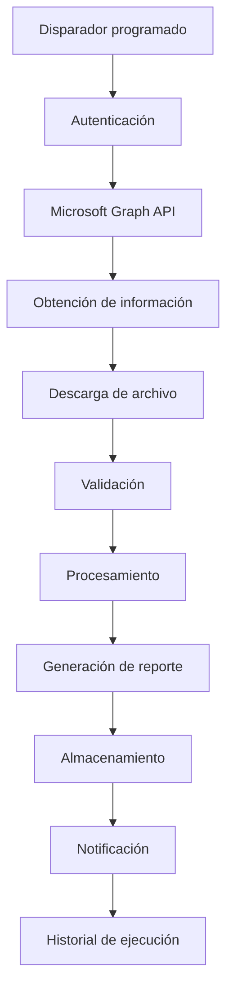

# De un proceso manual a una automatización centralizada

## Evolución de un proceso de reportería: Manual → Python → n8n

Este proyecto presenta un caso de estudio basado en mi experiencia profesional automatizando procesos operativos y de reportería.

El objetivo del repositorio no es reproducir sistemas internos ni publicar código perteneciente a una empresa.

Se trata de una **recreación técnica**, desarrollada con datos ficticios y componentes genéricos, que demuestra la evolución de un proceso desde una ejecución completamente manual hasta una arquitectura de automatización centralizada.

---

# Contexto

Mi acercamiento a la programación nació a partir de problemas reales que encontraba trabajando en Soporte Operacional.

Muchos procesos de reportería requerían tareas repetitivas como:

- descargar archivos;
- consultar información;
- procesar datos;
- aplicar filtros;
- generar reportes;
- guardar resultados;
- enviar archivos por correo;
- repetir el mismo procedimiento diariamente.

En lugar de limitarme a ejecutar estos procesos, comencé a analizar cuáles podían automatizarse.

Ese fue el punto de partida de mi transición desde Soporte Operacional hacia Programación, Automatización y posteriormente Desarrollo.

---

# Evolución de la solución

La solución atravesó tres etapas principales:

```text
ETAPA 1
Proceso manual
      ↓
ETAPA 2
Automatización con Python
      ↓
ETAPA 3
Automatización centralizada con n8n
```

Cada etapa resolvió problemas de la anterior y permitió incorporar nuevos conceptos de ingeniería y automatización.

---

# Etapa 1 — Proceso manual

Originalmente, el proceso de reportería era realizado manualmente.

Un usuario debía ejecutar diferentes tareas para obtener, procesar y distribuir la información.

Una representación simplificada del proceso sería:

```text
Usuario
   │
   ▼
Obtener información
   │
   ▼
Descargar archivos
   │
   ▼
Procesar datos
   │
   ▼
Aplicar filtros
   │
   ▼
Generar reporte
   │
   ▼
Guardar archivo
   │
   ▼
Enviar resultado
```

## Problemas detectados

Este modelo presentaba diferentes limitaciones:

- alta intervención humana;
- tareas repetitivas;
- tiempo operativo dedicado a reportería;
- posibilidad de errores manuales;
- dependencia de conocimiento operativo;
- dificultad para escalar el proceso;
- poca trazabilidad de las ejecuciones.

---

# Etapa 2 — Automatización con Python

Mientras trabajaba en Soporte Operacional identifiqué que gran parte de estas tareas podían automatizarse.

Esto dio origen a una de mis primeras aplicaciones prácticas de programación sobre procesos reales.

Comencé a desarrollar soluciones utilizando Python para automatizar tareas como:

- lectura de archivos;
- procesamiento de información;
- transformación de datos;
- aplicación de reglas;
- generación de reportes;
- generación de archivos Excel;
- automatización de correos;
- distribución de resultados.

La arquitectura comenzó a evolucionar hacia:

```text
Proceso
   │
   ▼
Script Python
   │
   ├── Lectura de datos
   │
   ├── Validaciones
   │
   ├── Transformaciones
   │
   ├── Procesamiento
   │
   └── Generación de reporte
   │
   ▼
Resultado
```

En algunos casos estas automatizaciones fueron empaquetadas como aplicaciones ejecutables para facilitar su utilización.

---

# Primer impacto

La incorporación de Python permitió reducir considerablemente la intervención manual necesaria para ejecutar procesos recurrentes.

Pero también representó algo importante en mi evolución profesional:

> Dejé de limitarme a operar procesos existentes y comencé a desarrollar soluciones para mejorarlos.

Este fue uno de los puntos de partida de mi camino hacia programación, automatización y desarrollo.

---

# Nuevos desafíos

A medida que aumentó la cantidad de automatizaciones también aparecieron nuevas necesidades.

Las soluciones basadas en scripts o ejecutables distribuidos resolvían el problema operativo inicial, pero introducían nuevos desafíos relacionados con:

- mantenimiento;
- distribución de versiones;
- dependencia de estaciones de trabajo;
- actualización de ejecutables;
- monitoreo;
- trazabilidad;
- configuración;
- resolución de errores;
- administración de múltiples automatizaciones.

Esto llevó a una nueva pregunta:

> ¿Cómo pasar de automatizar tareas individuales a administrar automatizaciones como una plataforma?

---

# Etapa 3 — Automatización centralizada con n8n

Al incorporarme al área de Desarrollo pude evolucionar este enfoque hacia una arquitectura más centralizada.

El objetivo ya no era solamente automatizar una tarea.

El objetivo pasó a ser construir procesos:

- centralizados;
- mantenibles;
- trazables;
- configurables;
- monitoreables;
- reutilizables.

Para esto comencé a utilizar n8n como plataforma de orquestación.

---

# Arquitectura conceptual

Una arquitectura simplificada puede representarse de la siguiente manera:



---

# Integración mediante APIs

Una de las mejoras arquitectónicas fue reemplazar dependencias locales por integraciones mediante APIs.

Por ejemplo:

```text
Automatización
      │
      ▼
Microsoft Graph API
      │
      ├── Correo
      ├── Archivos
      ├── SharePoint
      └── Notificaciones
```

Esto permite desacoplar la automatización de aplicaciones instaladas en una computadora específica.

---

# Centralización

La arquitectura evolucionó desde múltiples automatizaciones independientes hacia una plataforma centralizada.

```text
ANTES

Proceso A → Script / Ejecutable

Proceso B → Script / Ejecutable

Proceso C → Script / Ejecutable

Proceso D → Script / Ejecutable
```

hacia:

```text
AHORA

              Plataforma de automatización
                        │
                       n8n
                        │
          ┌─────────────┼─────────────┐
          │             │             │
          ▼             ▼             ▼
      Proceso A     Proceso B     Proceso C
          │             │             │
          └─────────────┼─────────────┘
                        │
                        ▼
                 Integraciones
```

---

# Separación entre operación y automatización

Otro objetivo importante fue reducir la necesidad de que usuarios operativos interactúen directamente con la implementación técnica.

El modelo buscado es:

```text
Usuario / Operación
        │
        │ solicita o consume
        ▼
      Resultado
        ▲
        │
        │
Plataforma de automatización
        │
        ├── Procesamiento
        ├── APIs
        ├── Validaciones
        ├── Archivos
        └── Notificaciones
```

La implementación técnica permanece centralizada y administrada mediante acceso controlado.

---

# Comparación de las tres etapas

| Característica | Proceso manual | Python | n8n centralizado |
|---|---|---|---|
| Intervención humana | Alta | Reducida | Mínima |
| Procesamiento automático | No | Sí | Sí |
| Ejecución programada | No | Posible | Sí |
| Dependencia de usuario | Alta | Media | Baja |
| Dependencia de PC | Alta | Media/Alta | Baja |
| Trazabilidad | Baja | Limitada | Centralizada |
| Mantenimiento | Manual | Por script | Centralizado |
| Integración mediante APIs | No | Posible | Sí |
| Historial de ejecuciones | No | Limitado | Sí |
| Control de acceso | Operativo | Distribuido | Centralizado |
| Escalabilidad | Baja | Media | Mayor |

---

# Tecnologías utilizadas

Este caso de estudio representa experiencia práctica con tecnologías como:

| Tecnología | Aplicación |
|---|---|
| Python | Primera etapa de automatización |
| Pandas | Procesamiento y transformación de datos |
| Excel | Generación de reportes |
| n8n | Orquestación de workflows |
| JavaScript | Transformaciones dentro de workflows |
| Microsoft Graph API | Integración con Microsoft 365 |
| OAuth 2.0 | Autenticación |
| SharePoint | Almacenamiento centralizado |
| Git | Control de versiones |
| GitHub | Documentación y portfolio |

---

# Principios aplicados

Durante la evolución de este tipo de soluciones fui incorporando diferentes principios.

## Automatización

Eliminar tareas repetitivas que no requieren intervención humana.

## Centralización

Evitar múltiples soluciones distribuidas difíciles de mantener.

## Trazabilidad

Poder conocer:

- cuándo se ejecutó un proceso;
- si terminó correctamente;
- dónde ocurrió un error;
- qué información procesó.

## Mantenibilidad

Diseñar soluciones que puedan modificarse sin depender de múltiples instalaciones.

## Separación de responsabilidades

Los usuarios operativos consumen el resultado del proceso sin necesidad de interactuar con la implementación técnica.

## Seguridad

Las credenciales y configuraciones sensibles no deben formar parte del código fuente.

---

# Manejo de errores

Una automatización productiva debe contemplar diferentes escenarios.

Por ejemplo:

```text
Inicio
  │
  ▼
¿Existe información?
  │
  ├── NO ──→ Registrar situación
  │
  └── SÍ
       │
       ▼
¿Formato válido?
       │
       ├── NO ──→ Registrar error
       │
       └── SÍ
            │
            ▼
        Procesar
            │
            ▼
      Generar reporte
            │
            ▼
        Notificar
```

Algunos errores que deben contemplarse:

- archivo inexistente;
- archivo vacío;
- columnas faltantes;
- formato incorrecto;
- error de autenticación;
- error de API;
- error durante el procesamiento;
- error durante el almacenamiento;
- error durante la notificación.

---

# Seguridad y confidencialidad

Este repositorio es una recreación educativa y profesional.

No contiene:

- código fuente propietario;
- información productiva;
- datos personales;
- nombres de clientes;
- credenciales;
- tokens;
- secretos;
- direcciones IP internas;
- rutas de red;
- nombres de servidores;
- configuraciones empresariales.

Todos los ejemplos utilizados en este repositorio deben utilizar datos ficticios.

---

# Variables de entorno

Las credenciales nunca deben almacenarse directamente dentro del código.

Ejemplo:

```env
TENANT_ID=your_tenant_id
CLIENT_ID=your_client_id
CLIENT_SECRET=your_client_secret
```

El archivo real `.env` nunca debe subirse al repositorio.

---

# Impacto

La evolución de este tipo de procesos permitió pasar de tareas completamente manuales hacia automatizaciones centralizadas.

## Evolución

```text
Trabajo manual
      ↓
Automatización
      ↓
Centralización
      ↓
Trazabilidad
      ↓
Mantenibilidad
      ↓
Escalabilidad
```

El principal aprendizaje fue comprender que automatizar no significa solamente escribir un script.

Una automatización profesional también debe ser:

- mantenible;
- observable;
- segura;
- reproducible;
- documentada;
- administrable.

---

# Evolución profesional

Este proyecto también representa una parte importante de mi evolución profesional.

```text
Soporte Operacional
        │
        ▼
Identificación de tareas repetitivas
        │
        ▼
Python
        │
        ▼
Automatización
        │
        ▼
Desarrollo
        │
        ▼
n8n
        │
        ▼
APIs
        │
        ▼
Arquitecturas centralizadas
```

Mi acercamiento al desarrollo nació de intentar resolver problemas reales que encontraba trabajando directamente con procesos operativos.

Con el tiempo, esas primeras automatizaciones evolucionaron hacia soluciones más estructuradas, centralizadas y mantenibles.

---

# Próximos pasos del proyecto

Este repositorio continuará incorporando ejemplos demostrativos de:

- workflow n8n;
- procesamiento de datos ficticios;
- generación automática de reportes;
- manejo de errores;
- integración mediante APIs;
- almacenamiento;
- notificaciones;
- métricas de ejecución;
- documentación de arquitectura.

---

# Aviso

Este proyecto es una recreación técnica basada en patrones generales de automatización y experiencia profesional.

No contiene código propietario, información productiva, credenciales, datos de clientes ni información confidencial perteneciente a empleadores o terceros.
