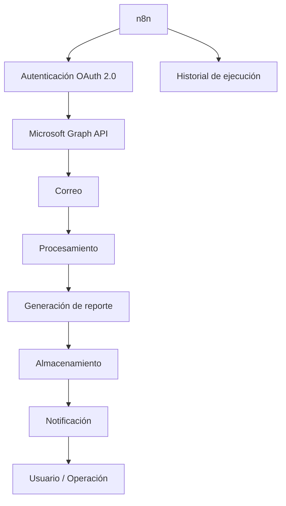

# Arquitectura

## Objetivo

El objetivo de esta arquitectura es centralizar procesos de automatización que originalmente requerían intervención manual o ejecución desde estaciones de trabajo.

La evolución conceptual es:

```text
Manual
   ↓
Python
   ↓
Automatización local
   ↓
n8n
   ↓
Automatización centralizada
```

---

# Arquitectura general



---

# Responsabilidades

## n8n

Responsable de:

- orquestar el proceso;
- ejecutar workflows;
- controlar el flujo;
- registrar ejecuciones;
- manejar errores.

## Microsoft Graph API

Responsable de proporcionar acceso mediante API a servicios de Microsoft 365.

## Procesamiento

Responsable de:

- validar información;
- transformar datos;
- aplicar reglas;
- generar resultados.

## Almacenamiento

Responsable de conservar los archivos generados.

## Notificación

Responsable de informar el resultado del proceso.

---

# Principio de diseño

Los usuarios operativos no necesitan conocer ni ejecutar la implementación técnica.

La arquitectura separa:

```text
USUARIO
   │
   ▼
RESULTADO
```

de:

```text
AUTOMATIZACIÓN
   │
   ├── APIs
   ├── Procesamiento
   ├── Validaciones
   ├── Almacenamiento
   └── Monitoreo
```

Esto permite reducir dependencias operativas y centralizar el mantenimiento.
